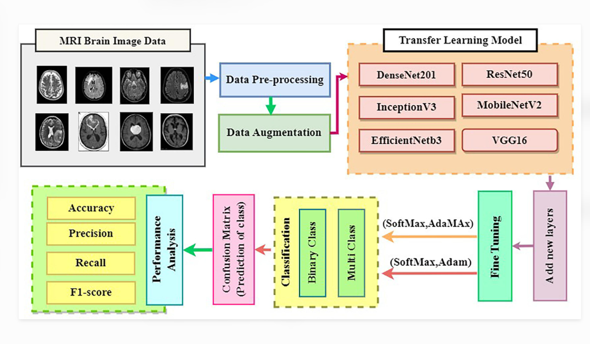

# MRI Brain Tumor Classification Using CNNs

A deep learning project focused on classifying brain MRI images into four categories using Convolutional Neural Networks (CNNs).

## Project Overview

This project explores different CNN architectures and optimization techniques for brain tumor classification.

**Classification Categories:**
- Glioma
- Meningioma
- Pituitary Tumor
- No Tumor

## Model and Optimization Techniques

- DenseNet-121
- Batch Normalization
- Weighted Pruning
- Layer Pruning
- Network Pruning
- CLIP-Q Quantization
- Depthwise Separable Convolution
- Tensor Decomposition
- Knowledge Distillation

## Technologies Used

Python | PyTorch | Torchvision | NumPy | Matplotlib | Scikit-learn | Jupyter Notebook

## Repository Contents

- `Source-Code/` – Python implementation and experiment visualizations.
- `MRI-Brain-Tumor-Classification-Project-Report.pdf` – Detailed project report, methodology, results, and graphs.

## System Architecture

The following diagram illustrates the overall workflow of the proposed brain tumor classification system.

## Project Documentation

Refer to the project report for detailed explanations of the models, optimization techniques, experimental results, and conclusions.

