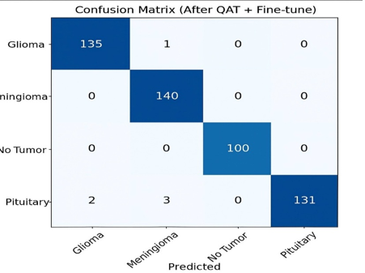
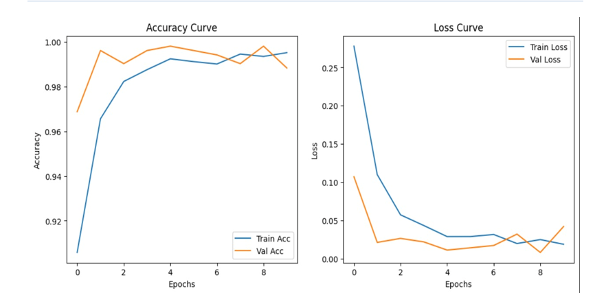

# MRI Brain Tumor Classification – Source Code

This folder contains the source code and experiment results for our project, **Study of Optimization Techniques and Their Implementation on CNN Models for Image Classification**.

## Project Overview
The project uses Deep Learning and Convolutional Neural Networks (CNNs) to classify brain MRI images into four categories:
- Glioma
- Meningioma
- Pituitary Tumor
- No Tumor

DenseNet-121 was selected for evaluating different optimization techniques.

## Implementation
The available Python implementation covers:

- DenseNet-121 model
- Weighted L1 Pruning
- 30% unstructured pruning
- Model training and validation
- Confusion matrix and classification report
- Accuracy and loss visualization

## Technologies Used
- Python
- PyTorch
- Torchvision
- NumPy
- Matplotlib
- Scikit-learn
- Jupyter Notebook

## Dataset Structure

The code expects the dataset to be organized as follows:

MRI_Datasets/
- Train/
  - Glioma/
  - Meningioma/
  - Pituitary/
  - No Tumor/
- Val/
  - Glioma/
  - Meningioma/
  - Pituitary/
  - No Tumor/

## Source File
- `weighted_pruning_densenet121.py` – Implements DenseNet-121 with weighted L1 pruning.

## Experiment Results

### Weighted Pruning – Confusion Matrix

### Weighted Pruning – Accuracy and Loss

## Project Report
Refer to the project report in the main repository for detailed methodology, experimental comparisons, graphs, and conclusions.
